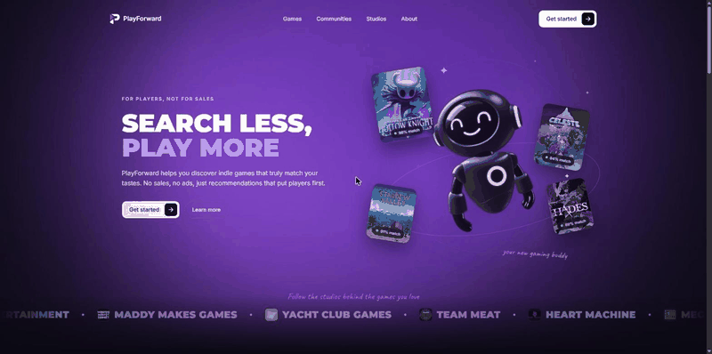
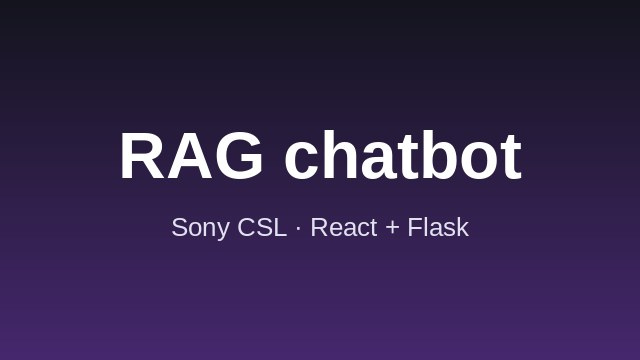

Hi, I'm Bradley 👋 — 5th-year software engineering student at **Epitech Paris**, building **front-end and full-stack** web apps with React, TypeScript and Next.js. I care about clean UI, accessibility and the details that make an interface feel good.

🔎 Looking for a **6-month end-of-studies internship** starting **March 1, 2027** (Paris area or remote)
💼 [LinkedIn](https://www.linkedin.com/in/bradley-malbrouck) · 📍 Paris, France · 🌴 from Réunion Island (974)

🎮 Currently building [**PlayForward**](https://playforward.fr), a recommendation platform and community hub for indie games — front end & accessibility

#### Projects

**[PlayForward](https://playforward.fr)** — indie game recommendations & community hub, team of 5, scrum. React 19, TypeScript, Vite, Tailwind CSS, accessibility (WCAG) linting

**[Miraiko](https://github.com/7Bradley7/miraiko-mirror)** — anime & manga recommendations that explain *why*, with AniList import (in progress, [miraiko.vercel.app](https://miraiko.vercel.app)). Next.js 16, React 19, Tailwind CSS 4, PostgreSQL, Prisma, Vercel

**[Dans la marmite de mémé](https://github.com/7Bradley7/dans-la-marmite-de-meme-mirror)** — narrative cooking game set in Réunion: learn grandma's recipes through mini-games. Vanilla HTML, CSS & JavaScript, no dependencies

**[AIR 974](https://github.com/7Bradley7/air-974-mirror)** — browser game console where your phones are the controllers (rooms, QR join, real-time, SDK). Front end, accessibility & brand identity

<b>RAG chatbot @ Sony CSL</b> — benchmarked LLMs on an existing RAG pipeline, built a Flask API and a React UI showing answers, source passages and book covers (historical market gardening archives)

Also: **AREA** (IFTTT-like automation platform, Next.js) · **R-Type** (multiplayer shoot'em up, C++, ECS, UDP)

#### Stack

#### Languages

🇫🇷 French (native) · 🇬🇧 English (C1) · 🌴 Réunion Creole · 🇨🇳 Mandarin (HSK 3)
