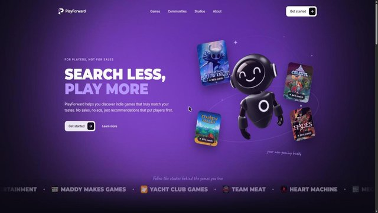
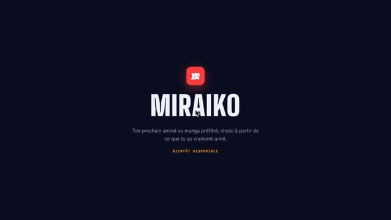
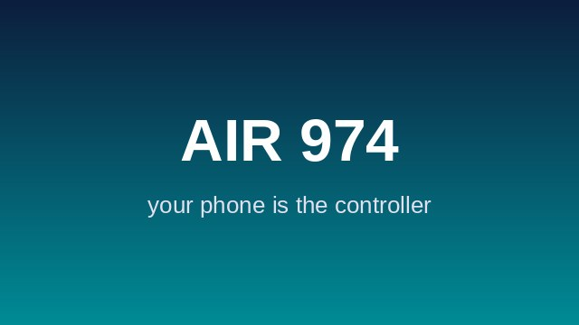
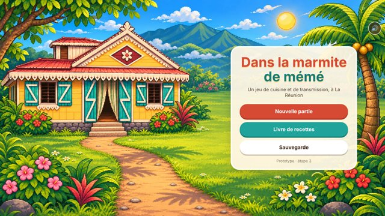
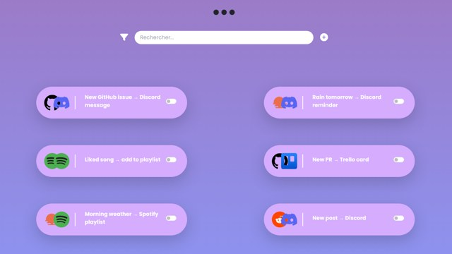
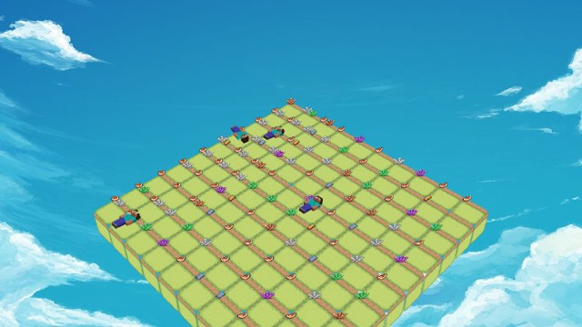
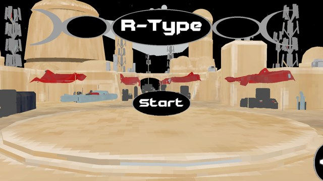
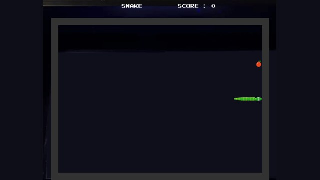

Hi, I'm Bradley 👋 — 5th-year software engineering student at **Epitech Paris**, building **front-end** web apps with React, TypeScript and Next.js. I care about clean UI, accessibility and the details that make an interface feel good.

🔎 Looking for a **6-month end-of-studies internship** starting **March 1, 2027** (Paris area or remote)
💼 [LinkedIn](https://www.linkedin.com/in/bradley-malbrouck) · 📍 Paris, France · 🌴 from Réunion Island (974)

🎮 Currently building [**PlayForward**](https://playforward.fr), a recommendation platform and community hub for indie games — front end & accessibility

#### Projects

**[PlayForward](https://playforward.fr)** — indie game recommendations & community hub, team of 5, scrum. React 19, TypeScript, Vite, Tailwind CSS, accessibility (WCAG) linting

**[Miraiko](https://github.com/7Bradley7/miraiko-mirror)** — anime & manga recommendations that explain *why*, with AniList import (in progress, [miraiko.vercel.app](https://miraiko.vercel.app)). Next.js 16, React 19, Tailwind CSS 4

**[AIR 974](https://github.com/7Bradley7/air-974-mirror)** — browser game console where your phones are the controllers: room code, real-time presses, latency measured on the phone. **Project lead** (product owner & scrum master): I run the Notion, sprint planning, task assignment, GitHub code reviews and retrospectives, and own the front end, accessibility & brand identity

**[Dans la marmite de mémé](https://github.com/7Bradley7/dans-la-marmite-de-meme-mirror)** — narrative cooking game set in Réunion: learn grandma's recipes through mini-games. Vanilla HTML, CSS & JavaScript, no dependencies

**[AREA](https://github.com/7Bradley7/area-mirror)** — IFTTT/Zapier-like automation platform, team of 5 (2 back end, web, mobile, full stack). I built most of the web front end on my own: Next.js, React, Tailwind CSS, with dark and accessibility modes

**[Zappy](https://github.com/7Bradley7/zappy-mirror)** — multiplayer network game (C server, raylib 3D GUI), team of 5. I wrote the AI client in Python: it connects over TCP, gathers resources and plays autonomously

**[R-Type](https://github.com/7Bradley7/rtype-mirror)** — multiplayer shoot'em up in C++20 with raylib, ECS architecture and UDP/TCP networking, team of 5

**[Arcade](https://github.com/7Bradley7/arcade-mirror)** — retro gaming platform in C++ that loads games and graphics libraries (SDL2, SFML, ncurses) at runtime. I made the Snake game module

#### Stack

#### Languages

🇫🇷 French (native) · 🇬🇧 English (C1) · 🌴 Réunion Creole · 🇨🇳 Mandarin (HSK 3)
